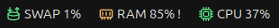
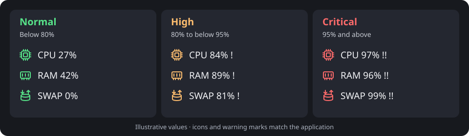

# Top Bar Resource Monitor

**CPU, RAM and swap usage at a glance, with coloured icons and warnings when usage stays high.**

[](https://github.com/magus-verma/topbar-resource-monitor/actions/workflows/tests.yml)
[](https://github.com/magus-verma/topbar-resource-monitor/releases/latest)
[](LICENSE)
[](#requirements)

<p align="center">
  
</p>

*Actual screenshot from Ubuntu 26.04.1 / GNOME 50 on Wayland. Cropped to the three resource widgets. Order and spacing follow your desktop's tray settings.*

[Install](#install) · [How it works](#how-it-works) · [Configure](#configure) · [Troubleshoot](#troubleshoot) · [Uninstall](#uninstall) · [Contribute](CONTRIBUTING.md)

## Features

- Three live indicators: **CPU %**, **RAM %**, and **SWAP %**, refreshed every two seconds.
- Green, amber and red status icons. Warning marks (`!` / `!!`) make high usage visible without relying on colour alone.
- Native desktop notifications after sustained high usage, with critical escalation and repeat limits.
- Click a widget for precise usage, memory capacity, free swap, a warning mute switch, and a shortcut to System Monitor.
- Per-user installation and automatic startup through a systemd user service.
- Updates preserve settings and keep a backup of the previous installation.
- Reads local Linux counters. No application telemetry, network requests or background data collection.

## Requirements

- Linux with **Python 3.10 or newer**, GTK 3, PyGObject, Ayatana AppIndicator 3 and libnotify bindings.
- A desktop with an active AppIndicator/StatusNotifier host. On GNOME this is normally the **Ubuntu AppIndicators** extension or **AppIndicator and KStatusNotifierItem Support**.
- A systemd user session for the automatic installer. Manual startup is also supported.

**Verified desktop:** Ubuntu 26.04.1 LTS, GNOME Shell 50.1, Wayland, ARM64. Unit tests also run on Python 3.10 and 3.14. Other distributions, architectures and desktops with compatible tray support are candidates for testing; they are not yet verified here.

This is a tray application. It uses the existing AppIndicator extension; it does not install a custom GNOME Shell extension. See the [AppIndicator project's documentation](https://github.com/ubuntu/gnome-shell-extension-appindicator) for desktop integration.

## Install

### 1. Install dependencies

On Ubuntu / Debian:

```sh
sudo apt update
sudo apt install git python3 python3-gi gir1.2-gtk-3.0 \
  gir1.2-ayatanaappindicator3-0.1 gir1.2-notify-0.7 librsvg2-common
```

Ubuntu's default GNOME session already provides Ubuntu AppIndicators. On another GNOME setup, install and enable [AppIndicator and KStatusNotifierItem Support](https://extensions.gnome.org/extension/615/appindicator-support/) using your distribution's supported extension tooling. New GNOME extensions may require logging out and back in. Once the tray host is active, this application can start immediately.

Optional, for the **Open System Monitor** menu action:

```sh
sudo apt install gnome-system-monitor
```

The application also recognises Mission Center, or `btop` with Ptyxis, GNOME Terminal, Console (`kgx`), or xterm.

### 2. Clone and install as your desktop user

```sh
git clone https://github.com/magus-verma/topbar-resource-monitor.git
cd topbar-resource-monitor
./install.sh
```

Run `install.sh` **without sudo**. The installer checks dependencies, installs the files in your home directory, starts the monitor, and enables it for future graphical sessions. Allow a few seconds for the first readings.

Prefer an archive? Download the source package and its `SHA256SUMS` from the [latest release](https://github.com/magus-verma/topbar-resource-monitor/releases/latest), verify the checksum, extract it, and run `./install.sh` from the extracted directory.

### Update

```sh
cd topbar-resource-monitor
git pull --ff-only
./install.sh
```

Existing `config.json` is preserved. Previous files and settings are backed up under `~/.local/state/topbar-resource-monitor/backups/`; the installer prints the exact backup path.

### Manual or offline installation

```sh
./install.sh --no-start
/usr/bin/python3 ~/.local/share/topbar-resource-monitor/monitor.py
```

`--no-start` copies files without checking desktop dependencies or touching systemd. Install the dependencies yourself before launching. For automatic startup later:

```sh
systemctl --user daemon-reload
systemctl --user enable --now topbar-resource-monitor.service
```

## How it works

| State | Default usage | Top bar | Notification behaviour |
| --- | --- | --- | --- |
| Normal | Below 80% | Green icon | No warning |
| High | 80% to below 95% | Amber icon and `!` | Warning after at least 10 seconds of continuously sampled high usage |
| Critical | 95% and above | Red icon and `!!` | Critical warning after at least 10 seconds at this level |
| Unavailable | Sampling unavailable | Grey icon and `--%` | No warning while unavailable |
| Swap disabled | No swap capacity | Grey icon and `SWAP off` | Swap warnings inactive |



*The state examples above use illustrative values. The screenshot at the top of this README is a real desktop capture.*

Colours change on the next sample. Notifications wait for sustained usage, so a brief CPU spike does not trigger a warning. A resource can escalate from high to critical immediately after its critical sustain window. During continuous high usage, repeat notices are limited to one every five minutes per resource. Once usage falls more than five percentage points below the warning threshold, a new high-usage episode can warn again. A sampling gap or suspend/resume starts a fresh sustain window. Notification presentation follows your desktop's notification settings.

**CPU** is the average busy percentage across all cores, calculated from `/proc/stat`; idle and I/O wait count as non-busy. A fully occupied single core will therefore not show 100% on a multicore machine.

**RAM** is `(MemTotal - MemAvailable) / MemTotal`. Reclaimable cache is accounted for by `MemAvailable`. **Swap** is `(SwapTotal - SwapFree) / SwapTotal`, summed across enabled swap devices. On zram setups this is logical swap capacity, not compressed physical RAM consumption. These counters are documented in the [Linux kernel's `/proc` reference](https://www.kernel.org/doc/html/latest/filesystems/proc.html).

Swap usage can remain nonzero after RAM pressure subsides. A high swap percentage is a capacity warning; it is not a measurement of current swapping speed. The application does not change swap, kill processes or manage memory for you.

## Configure

Edit `~/.config/topbar-resource-monitor/config.json`:

```json
{
  "warning_percent": 80,
  "critical_percent": 95,
  "sustain_seconds": 10,
  "repeat_seconds": 300,
  "poll_seconds": 2
}
```

The same thresholds apply to CPU, RAM and swap. Settings may be omitted to use defaults. Percentages must satisfy `0 < warning_percent < critical_percent <= 100`; sustain time must be at least 2 seconds, repeat time at least 60 seconds, and polling a whole number of seconds at least 1. Values must be finite numbers. Recovery hysteresis is five percentage points, or half the warning threshold when that threshold is below 10%.

Restart after editing:

```sh
systemctl --user restart topbar-resource-monitor.service
```

If `XDG_CONFIG_HOME` is set, configuration and the service file use that directory instead of `~/.config`. The menu's **Mute usage warnings** applies to all three indicators for the current run; percentages and colours continue updating.

## Troubleshoot

**Service status and recent logs**

```sh
systemctl --user status topbar-resource-monitor.service
journalctl --user -u topbar-resource-monitor.service -n 50 --no-pager
```

**No widgets:** Check that your desktop's AppIndicator/StatusNotifier extension is enabled and user extensions are allowed. GNOME's own built-in status icons do not imply AppIndicator support. Restart the service after enabling the host. On GNOME, `gnome-extensions list --enabled` helps identify enabled extensions.

**No notifications:** Check the menu's mute switch and the desktop's notification/banner settings. Alerts require sustained sampled usage; colours can change before a notification appears.

**Grey widgets:** Check logs and readable `/proc/stat` and `/proc/meminfo`. A grey `SWAP off` means there is no enabled swap and is expected.

**Monochrome icons:** Check the AppIndicator extension's icon saturation setting. Some themes or tray hosts apply their own visual effects.

**System Monitor does not open:** Install one of the supported monitor applications described above. The indicators and alerts work independently of that optional application.

**Sample the real counters without opening the tray**

```sh
/usr/bin/python3 ~/.local/share/topbar-resource-monitor/monitor.py --sample
```

**Older library deprecation notices:** Some distributions report that `libayatana-appindicator` is deprecated in favour of its newer GLib library. Version 0.1 uses the GTK 3 bindings available on the verified desktop; that startup notice is not a sampling failure.

## Uninstall

From your source checkout or extracted release:

```sh
./uninstall.sh
```

This stops and disables the service and removes its application files. Settings and earlier backups are retained. To also remove `config.json`:

```sh
./uninstall.sh --purge
```

For an offline/manual installation without a systemd user session, use `./uninstall.sh --no-service` after stopping any manually launched process.

## Project status and contributions

This is an initial public release with a working desktop installation, real screenshot, tested resource calculations and warning timing, and isolated installer/upgrade/uninstaller tests. CI does not claim end-to-end desktop coverage.

See [CONTRIBUTING.md](CONTRIBUTING.md), [CHANGELOG.md](CHANGELOG.md), [SECURITY.md](SECURITY.md), and [CODE_OF_CONDUCT.md](CODE_OF_CONDUCT.md). Report bugs or request features using the [issue templates](https://github.com/magus-verma/topbar-resource-monitor/issues/new/choose).

Licensed under [MIT](LICENSE). GTK, Ayatana and other system dependencies retain their own licences. The installer and application use standard-library Python plus distribution-provided desktop bindings; there are no pip runtime dependencies.
